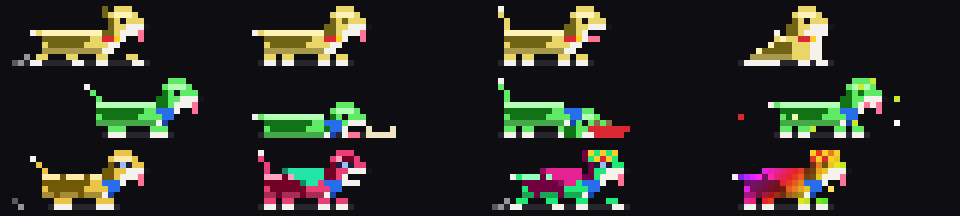

# claude-code-dog 🐕

An animated pixel-art dog that lives in your [Claude Code](https://claude.com/claude-code) status line.
It runs, fetches, digs, rolls over and chases its tail while Claude works, reacts to what Claude is
doing, and levels up from the tokens Claude writes for you.



## What it does

- **Lives in the status line.** A 5-line truecolor half-block sprite that runs back and forth across
  your terminal while Claude is busy, and curls up for a nap when it's done.
- **Has a life of its own.** Every few seconds it picks something to do: fetch a tennis ball, fetch a
  stick, roll over, zoomies-into-a-tumble, chase its tail, dig, scratch, sniff, bark, wag. Very
  rarely it pees or poops. (These are worth XP.)
- **Reacts to Claude's tools.**

  | Claude is…                      | The dog…                               |
  |---------------------------------|----------------------------------------|
  | reading / searching / browsing  | sniffs around (`*sniff* main.py`)      |
  | running a shell command         | digs (`digging: git status`)           |
  | editing a file                  | lies down and chews a bone             |
  | launching a subagent            | goes for a fetch run                   |
  | hitting a tool error            | growls, angry eyebrows                 |
  | seeing your tests pass          | confetti                               |

- **Levels up.** XP = output tokens Claude writes (including subagents). 100 levels, tuned so early
  levels come daily and the late game takes years. Every level gets its own coat color.
- **Earns gear.** Bandana (Lv 10), spotted coat (20), sunglasses (30), superhero cape (40),
  two-tone coat (50), crown (70), sparkles (80), animated rainbow (100).
- **Gets hungry.** The food bowl empties over ~8 hours. Feed it with `/walkies treat` and you earn
  +10% XP while it's more than half full. Let it starve and it sits there begging.
- **Badges.** Seven achievements (some of them involve the lawn), each with an XP bonus.
- **Custom spinner verbs.** "Bark bark…", "Sniffing around…", "Chewing on it…".

## Install

Requires Python 3.8+ (the one that ships with macOS is fine) and a terminal with truecolor.

```bash
git clone https://github.com/JeffPHenry/claude-code-dog.git
cd claude-code-dog
./install.sh
```

Then restart Claude Code. The installer copies `dog.py` to `~/.claude/dog/`, adds the `/walkies`
command, and merges the status line, spinner verbs and hooks into `~/.claude/settings.json`, keeping
everything already there (a timestamped backup is written first). If you already have a
`statusLine`, it gets replaced, and it's in the backup.

Respects `CLAUDE_CONFIG_DIR` if you use a non-default config directory.

## Commands

| Command            | What it does                                        |
|--------------------|-----------------------------------------------------|
| `/walkies`         | toggle the dog on/off (XP keeps counting when off)  |
| `/walkies treat`   | feed the dog                                        |
| `/walkies stats`   | level, XP breakdown, pace, badges, gear ETA dates   |
| `/walkies ascii`   | switch to the old-school text dog                   |
| `/walkies pixel`   | back to pixel art                                   |

`~/.claude/dog/dog.py table` prints the full level table.

## Privacy

Everything stays on your machine. The dog reads your local Claude Code transcripts only to count
output tokens, keeps its state in `~/.claude/dog/`, and never touches the network.

## Uninstall

```bash
./uninstall.sh            # remove everything
./uninstall.sh --keep-xp  # remove, but keep your level for later
```

## License

MIT
